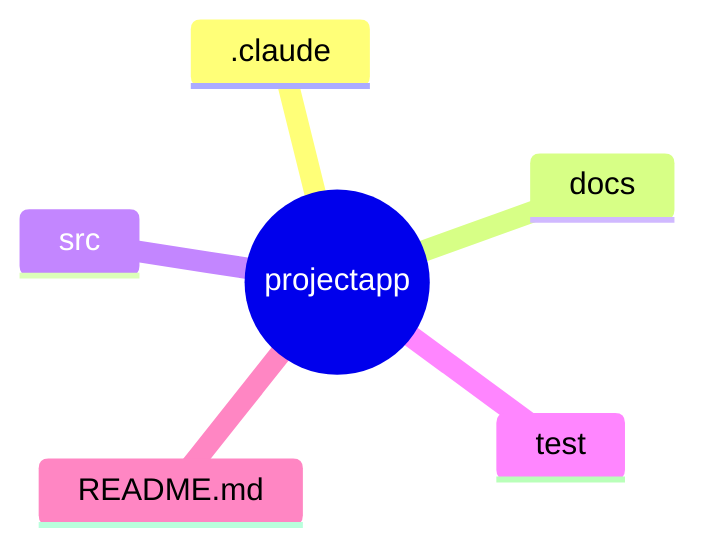

# RULE

## ディレクトリ構成

## パッケージャー

- uv

## コード規約

- `The Zen of Python`（REPLで、`import this`で表示される）と[PEP8](https://pep8-ja.readthedocs.io/ja/latest/)とする
- 型ヒント記述とする
  - すべての関数には、型引数、戻り値を指定すること
-  型ヒントはtyで、検証する
-  コメントの説明は、多くても3行以内にすること

## テスト

### Unit Test

- Pytest

### 実装ごとの確認(smoke テスト)

- 実装(機能の追加・修正・リファクタリング)のたびに、`uv run pytest -m smoke`(約 450 件・10 秒以内)を実行する
- smoke が失敗したら、詳細を確認するために全テスト(`uv run pytest`。約 5 分。120 秒を超えるのでバックグラウンドで実行する)を実行する
- 全テストは、PR・コミットの前にも実行する(smoke だけで済ませない)
- 新しいコア機能のテストを足すときは、`docs/development.md`の「smoke テスト」の基準に従ってタグを付ける

### カバレッジ

- pytest-cov

### 型ヒント

- ty

## 現在の状況記録と、業務の再開について

- `現在の作業を記録して`で、現在の作業状況を`.claude/MEMORY.md`に要約保存する
- 引き継ぎ資料は作成する
- `業務再開して`または、`開始`で`状況記録`を確認する
