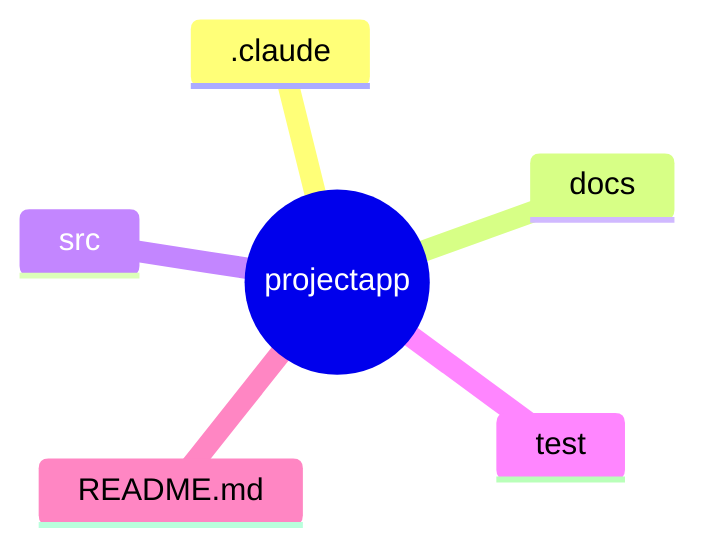

# RULE

## ディレクトリ構成

## パッケージャー

- uv

## 仕様の文書

- `CLAUDE.md`は入口で、200 行以内に保つ。詳しい仕様は`.claude/spec/`に話題別に置く(索引は`CLAUDE.md`)
- 仕様を変えたら、該当する`.claude/spec/`のファイルを更新する。`CLAUDE.md`に詳細を書き足さない

## コード規約

- `The Zen of Python`（REPLで、`import this`で表示される）と[PEP8](https://pep8-ja.readthedocs.io/ja/latest/)とする
- 型ヒント記述とする
  - すべての関数には、型引数、戻り値を指定すること
-  型ヒントはtyで、検証する
-  コメントの説明は、多くても3行以内にすること

## テスト

### Unit Test

- Pytest

### 実装ごとの確認(smoke テスト)

- 実装(機能の追加・修正・リファクタリング)のたびに、`uv run pytest -m smoke`(約 450 件・10 秒以内)を実行する
- smoke が失敗したら、詳細を確認するために全テストを実行する
- 全テストは、PR・コミットの前にも実行する(smoke だけで済ませない)
- 全テストは、`pytest-xdist` で並列にして、`uv run pytest -n auto` で実行する(約 4,500 件で約 1 分。直列の `uv run pytest` は約 5 分)。Bash の既定の待ち時間(120 秒)に近いので、`timeout` を長くするか、バックグラウンドで実行する
- 並列で失敗の原因が分かりにくいときは、失敗したテストだけを直列(`-n 0`)で実行し直す
- 新しいコア機能のテストを足すときは、`docs/development.md`の「smoke テスト」の基準に従ってタグを付ける

### カバレッジ

- pytest-cov

### 型ヒント

- ty

### lint とフォーマット(ruff)

- 設定は`pyproject.toml`の`[tool.ruff]`。実行は`uvx ruff`(依存には入れない)
- 実装の完了時(PR・コミットの前)に、全テストと合わせて次を実行する
  - `uvx ruff check`(指摘が 0 件であること。`--fix`で直せるものは直す)
  - `uvx ruff format src test`(整形したあと、`uvx ruff format --check src test`で差分がないこと)
- format で変わったファイルがあれば、テストの前に実行し、そのあとの全テストで確認する

## 現在の状況記録と、業務の再開について

- `現在の作業を記録して`で、現在の作業状況を`.claude/MEMORY.md`に要約保存する
- 引き継ぎ資料は作成する
- `業務再開して`または、`開始`で`状況記録`を確認する
